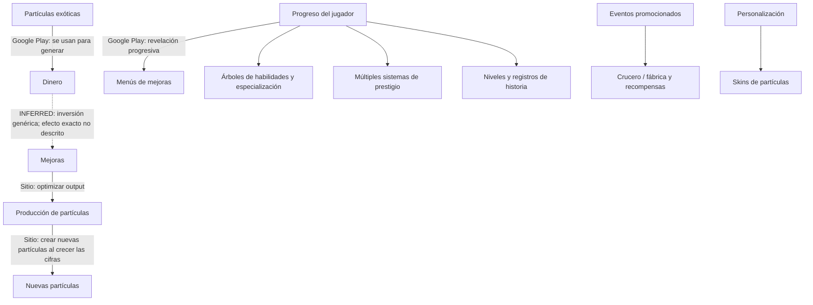

# Mapa de progresión observable

**Fecha de corte:** 2026-10-13.  
Este es un mapa de afirmaciones promocionales, no un árbol completo de requisitos comprobados. Fuentes: [S1], [S2], [S3] en el [registro](./official-sources.md).

## Grafo de evidencia a alto nivel



Las aristas etiquetadas como afirmaciones de fuente reflejan solo el vínculo expresamente anunciado. La arista discontinua es una **inferencia** general, no una regla verificada. El grafo no especifica prerequisitos, orden temporal ni causalidad que las fuentes no den.

## Inventario por horizonte

| Horizonte | Evidencia disponible | Estado |
|---|---|---|
| Inicio | No hay descripción del estado inicial, tutorial ni primera acción. | **UNKNOWN** |
| Temprano | Dinero mediante partículas y mejoras en sentido amplio. [S2] | **VERIFIED** como descripción; orden y tiempos **UNKNOWN** |
| Medio | Menús que se desbloquean progresivamente, árboles de habilidades, especialización y nuevas partículas. [S1], [S2] | **VERIFIED** como categorías promocionadas; dependencias/umbrales **UNKNOWN** |
| Tardío | Miles de mejoras, sistemas de prestigio múltiples, crecimiento a números muy grandes. [S1], [S2] | **VERIFIED** como promesa de contenido; estados, duración y capas **UNKNOWN** |
| Temporal/paralelo | Eventos mensuales de crucero/fábrica y recompensas. [S1] | **VERIFIED** como promoción; calendario y disponibilidad en versión actual **UNKNOWN** |

No se asignan duraciones ni una lista de hitos a estas etapas: no hay sesiones ni cifras observadas.

## Relaciones anunciadas y dependencias desconocidas

- **VERIFIED:** el texto del sitio enlaza crecimiento de las cifras con crear nuevas partículas [S1].
- **VERIFIED:** Google Play afirma que algunos menús se revelan progresivamente con el avance [S2].
- **VERIFIED:** se anuncian árboles, especialización y “new paths” [S1]; la imagen oficial muestra nodos conectados [S3].
- **VERIFIED:** se anuncian varios sistemas de prestigio y nuevo contenido [S2].
- **UNKNOWN:** cuál es el primer sistema, qué desbloquea los demás y si los eventos/árboles participan en esas dependencias.
- **UNKNOWN:** valores de cualquier umbral, prerrequisitos explícitos, contenido mutuamente excluyente y reseteable.

## Siguiente esquema de captura

En una observación directa, usar IDs provisionales del cuaderno y no inventar IDs de producto:

```text
nodo: nombre mostrado | tipo | requisito visible | estado antes/después
arista: nodo origen -> nodo destino | texto de requisito o acción | evidencia
evento: fecha | versión | estado previo | acción | cambio/recompensa
```

Convertir luego los nombres en IDs estables solo para el modelo del juego original. Para documentar ISEPS, preservar siempre el texto visible y separar normalización de observación.

## Propuesta para nuestro proyecto (ORIGINAL PROPOSAL)

Comenzar con una escalera explícita y propia: recurso inicial → productor → mejora → segundo sistema desbloqueado → decisión de especialización. Exponer cada requisito y recompensa; incorporar prestigio una vez que el bucle base y los tiempos de progresión se hayan medido. No clonar un árbol desconocido a partir de una imagen promocional.
